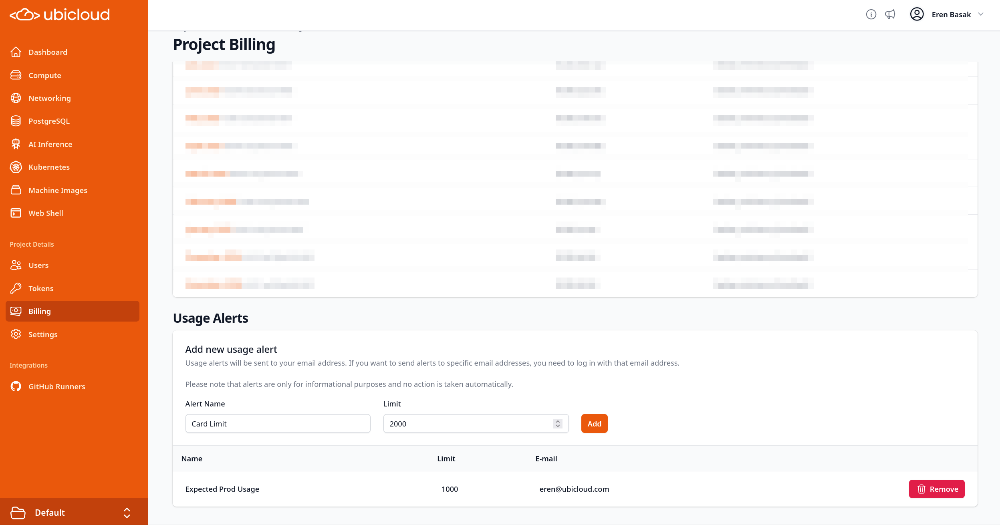

import { PrList } from "/snippets/pr-list.mdx";

## GitHub Runners

### Faster Runner Starts During Peak Demand

8 vCPU runners now spill over to AWS when they can't be placed on Ubicloud's own hardware, joining 16 and 30 vCPU runners. A runner that waits more than 60 seconds for a host on Ubicloud's own hardware moves to AWS when the project's quota and global spill capacity allow. 

AWS-hosted GitHub runners now also share one VPC per installation and location, instead of each runner getting its own VPC, internet gateway, route table, and security group. This speeds up runner startup and keeps VPC usage from following runner churn. A runner still gets a dedicated subnet while its installation's subnet is being destroyed. 

### Opt-in Runner Placement Restrictions (Preview)
 
Overflow capacity doesn't support nested virtualization (KVM). If some of your jobs need KVM, reach out and we can keep specific repositories, or your whole project, on bare-metal runners. We can also enforce a hard concurrency limit so your project never runs more runners than its quota.
 
<PrList ids={[6584, 6742, 6561, 6562, 6563, 6731, 6755, 6681, 6667, 6783]} />

## AI & GPUs

### Dedicated NVIDIA B300 Hosts
 
You can now rent a dedicated NVIDIA B300 host, or a share of one such as half a host, in our SF Bay Area location for a flat monthly fee. Only your project's VMs run on your share, and the matching portion of the host's CPUs, memory, and storage is reserved for them. Reach out if you're interested.
 
<PrList ids={[6652]} />

## Console & UI

### Usage Alerts Account for Discounts and Credits

Usage alerts now compare your usage after discounts but before credits. A 100% discount no longer triggers an alert, and credits don't hide usage above your threshold: with a $100 alert, $200 of credit, and $150 of usage, you'll still be alerted because you've used more than $100 of your credit.

### OIDC Group Access with Custom Claims

Group-based access now works with identity providers that put groups in a namespaced claim, such as Okta, Cognito, and Auth0. Set a groups claim on the OIDC provider alongside the group prefix, and Ubicloud reads groups from the ID token, falling back to the userinfo endpoint. Groups sent as a single string are now accepted, and groups are no longer dropped when the ID token has no email.

### CLI Hides Secrets by Default

`ubi pg show` no longer prints full connection strings by default; use `-f connection-string` to include them. `ubi ai api-key list` now shows only key IDs, while `ubi ai api-key show` and `create` still print the key. Scripts that read connection strings from the default `pg show` output need to request the field explicitly.

<PrList ids={[6575, 6736, 6553, 6764]} />

## Managed PostgreSQL
 
### Larger and Storage-Optimized Instances (Preview)
 
Managed PostgreSQL now offers `48xlarge` sizes (192 vCPUs, 1,536 GiB memory) for the AWS storage-optimized `i7i`, `i7ie`, `i8g`, and `i8ge` families. On Google Cloud, the storage-optimized `z3` families and the AMD EPYC `n2d` families, where you choose how much local NVMe storage to attach, are available along with a new europe-west1 (Belgium) location. Reach out if you're interested.

### Simpler Database Creation
 
Standard PostgreSQL is now the only flavor, so the console replaces the flavor picker with a single "Create PostgreSQL Database" button. The `flavor` parameter is deprecated in the API and CLI but still accepted, so existing scripts and Terraform configurations keep working.

<PrList ids={[6634, 6635, 6572, 6736, 6737, 6741]} />

## Ubicloud Kubernetes

### New Service Hostname Domain

New Kubernetes clusters are now created with an updated service hostname domain. Existing clusters keep their current hostnames unchanged.

<PrList ids={[6586, 6587]} />